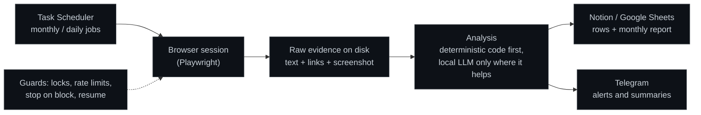

# Automation Portfolio

**The systems I design and run in production, in one place: market intelligence, a sales
operating system, AI visibility tracking, local SEO audits and outreach scheduling.**

I work in sales. My programming is self-taught: I design each system, set its rules, decide every
trade-off and run it day to day, and I write the code with AI assistants, choosing a different
one depending on the part of the system (coding, data extraction, analysis). Every change is
tested and verified on the real machine before it counts as done; how I work is in
[docs/how-i-build.md](docs/how-i-build.md).

## Projects

| Project | What it does | In production |
|---|---|---|
| [**market-intelligence-agent**](https://github.com/miguelmoga2002-alt/market-intelligence-agent) | 24/7 market intelligence over second-hand marketplaces, with a local LLM agent that answers questions over the data | 700K+ listings from 12 marketplaces in 9 countries, ~5K new a day |
| [**revenue-os-public-preview**](https://github.com/miguelmoga2002-alt/revenue-os-public-preview) | The sales operating system I'm building for our family businesses: pipeline, account view, next-action focus, CRM migration | Public technical preview, synthetic data |
| [**ai-visibility-tracker**](https://github.com/miguelmoga2002-alt/ai-visibility-tracker) | Asks 6 AI assistants the questions a customer would ask, every month, and measures whether they recommend the business | 156 answers a month; November 2026 round: 156 of 156 valid |
| [**gbp-audit**](https://github.com/miguelmoga2002-alt/gbp-audit) | Reads the Google Maps profiles of a business and its competitors and turns them into a list of concrete gaps | 13 profiles a month |
| [**timezone-outreach-scheduler**](https://github.com/miguelmoga2002-alt/timezone-outreach-scheduler) | Plans each market's daily outreach inside its own local morning, at a human pace | 30 contacts a day across two markets, DST-safe |

The tracker, the audit and the scheduler share the same backbone: scheduled jobs on one Windows
server, raw evidence saved to disk before anything is analyzed, results published to Notion or
Google Sheets, and Telegram for anything that needs me.

## Principles that run through all three

- **Evidence first.** Every answer or profile is saved as raw text and a screenshot before any
  analysis. If the analysis changes, the month can be re-scored without asking again.
- **The model proposes, the code verifies.** A local LLM (Qwen 2.5 14B on Ollama) extracts the
  businesses an AI answer recommends, but a name is only accepted if it appears literally in the
  answer. Detection, positions and percentages are computed by code.
- **Comparable over time.** Questions have permanent numbers that are never reused, so a month is
  always compared with the same question set.
- **Polite by design.** Fixed caps per run, random pauses between actions, and the job stops at
  the first block, limit or login wall and records it as such instead of counting it as data.
- **Configuration over code.** Site selectors, questions, competitors and time windows live in
  config files: a site redesign or a new country is a config change.

Each project has its own README and a runnable demo.

## Tech stack

Node.js, Python (FastAPI), PostgreSQL, PowerShell, Playwright, Ollama with Qwen (local), Notion API,
Google Sheets API, Telegram Bot API, Docker, GitHub Actions, Windows Task Scheduler, Git.

## Contact

[miguelmoralesgarcia.es](https://miguelmoralesgarcia.es) · [LinkedIn](https://www.linkedin.com/in/miguelmoralesgarcia/)

## License

MIT. See [LICENSE](LICENSE).
