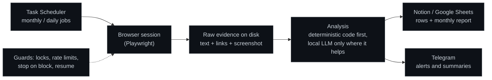

# Automation Portfolio

**Three automation systems I designed and run in production for my own work: a monthly panel
that measures whether AI assistants recommend my family's business, a Google Business Profile
audit of its local competitors, and a time-zone-aware outreach scheduler for my job search.**

I work in sales. My programming is self-taught: I design each system, set its rules, decide every
trade-off and run it day to day, and I write the code with AI assistants, choosing a different
one depending on the part of the system (coding, data extraction, analysis). Every change is
tested and verified on the real machine before it counts as done; how I work is in
[docs/how-i-build.md](docs/how-i-build.md).

> **What this repo is.** A public, sanitized view of private production code. Each folder
> explains a system and contains a small runnable module from it, with tests, on fictional data.
> Browser automation, credentials, real competitors, contacts and client data stay private.

My larger project, a 24/7 market-intelligence system over 12 marketplaces in 9 countries, has its
own repo: [market-intelligence-agent](https://github.com/miguelmoga2002-alt/market-intelligence-agent).

## At a glance

| System | What it does | In production |
|---|---|---|
| [**GEO visibility panel**](geo-visibility-panel/) | Asks 6 AI assistants the questions a customer would ask, every month, and measures whether they recommend the business, in what position, next to which competitors and citing which sources | 26 questions × 6 AI surfaces = 156 answers a month; November 2026 round: 156 of 156 valid |
| [**GBP audit**](gbp-audit/) | Reads the Google Maps profiles of the business and its competitors and turns them into a list of concrete gaps | 13 profiles a month; first run found our own website link with the wrong tracking campaign |
| [**Outreach scheduler**](outreach-scheduler/) | Sends a daily queue of connection requests in each country's local morning, with human pacing, and learns who accepted | 30 a day to Dublin and Dubai, each between 07:00 and 08:00 local time, DST-safe |

All three share the same backbone: scheduled jobs on one Windows server, raw evidence saved to
disk before anything is analyzed, results published to Notion or Google Sheets, and Telegram for
anything that needs me.



## Principles that run through all three

- **Evidence first.** Every answer or profile is saved as raw text and a screenshot before any
  analysis. If the analysis changes, the month can be re-scored without asking again.
- **The model proposes, the code verifies.** A local LLM (Qwen 2.5 14B on Ollama) extracts the
  businesses an AI answer recommends, but a name is only accepted if it appears literally in the
  answer. Detection, positions and percentages are computed by code.
- **Comparable over time.** Questions have permanent numbers that are never reused, so a month is
  always compared with the same question set.
- **Polite by design.** Fixed caps per run, random pauses between actions, and the job stops at
  the first block, limit or login wall and records it as such instead of counting it as data.
- **Configuration over code.** Site selectors, questions, competitors and time windows live in
  config files: a site redesign or a new country is a config change.

## Run the demos

Node.js 20 or newer, no dependencies.

```bash
npm test                 # 15 tests across the three modules
npm run demo:geo         # analyze fictional AI answers and compute share of voice
npm run demo:gbp         # audit three fictional Google Business Profiles
npm run demo:outreach    # plan a day of outreach across Dublin and Dubai time zones
```

## Repository layout

```
geo-visibility-panel/   answer analyzer and share-of-voice report (+ demo data)
gbp-audit/              profile signals and gap list (+ demo data)
outreach-scheduler/     local-time windows and pacing (+ demo)
test/                   node:test suites
docs/how-i-build.md     how I design, build and verify these systems
```

## Tech stack

Node.js, PowerShell, Playwright, Ollama with Qwen 2.5 14B (local), Notion API, Google Sheets
API, Telegram Bot API, Windows Task Scheduler, Git.

## License

MIT. See [LICENSE](LICENSE).
