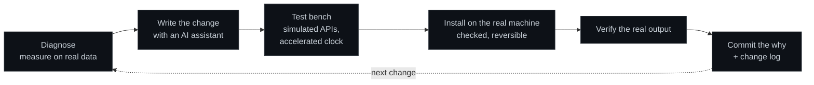

# How I build

I am not a software engineer by training. I learned to program on my own, by building the tools my
work needed. I design each system, set the rules it follows, decide every trade-off and run it in
production. I write the code with AI assistants, and I use different ones for different jobs:
one to program, a local model on my own GPU to read and extract data, others to research and
review. What makes it work is the protocol around them.

## The protocol

- **Diagnose before touching.** Read the logs and measure on real data before proposing a fix.
- **Test benches.** Each change is exercised against simulated services (Sheets, Telegram, the
  target site) with a clock that runs hundreds of times faster, so a full day of scheduling runs
  in seconds. Edge cases get their own test: daylight-saving days, a run that starts late,
  a lock left behind, a file with a different line ending.
- **Installers that refuse to guess.** A change is delivered as a script that first checks the
  fingerprint of every file it will modify and stops if the file is not the version it was
  tested against. It backs everything up, applies the change, runs the tests on the real machine
  and undoes everything if any step fails.
- **Done means verified.** A change counts only when its real output on the production machine
  shows it working.
- **A written why.** Every commit explains why the change was needed and how it was verified, and
  every production change gets a row in a change log with the lesson learned. Mistakes are paid
  for once.

## Lessons I apply everywhere

- Let the model propose and the code verify; never let a model produce a number or a link.
- A check that never fires is not proof that things work. Test it against a known failure.
- Save the raw evidence first; analysis can be redone, a question asked last month cannot.
- When a platform pushes back, slow down or stop. Never insist.
